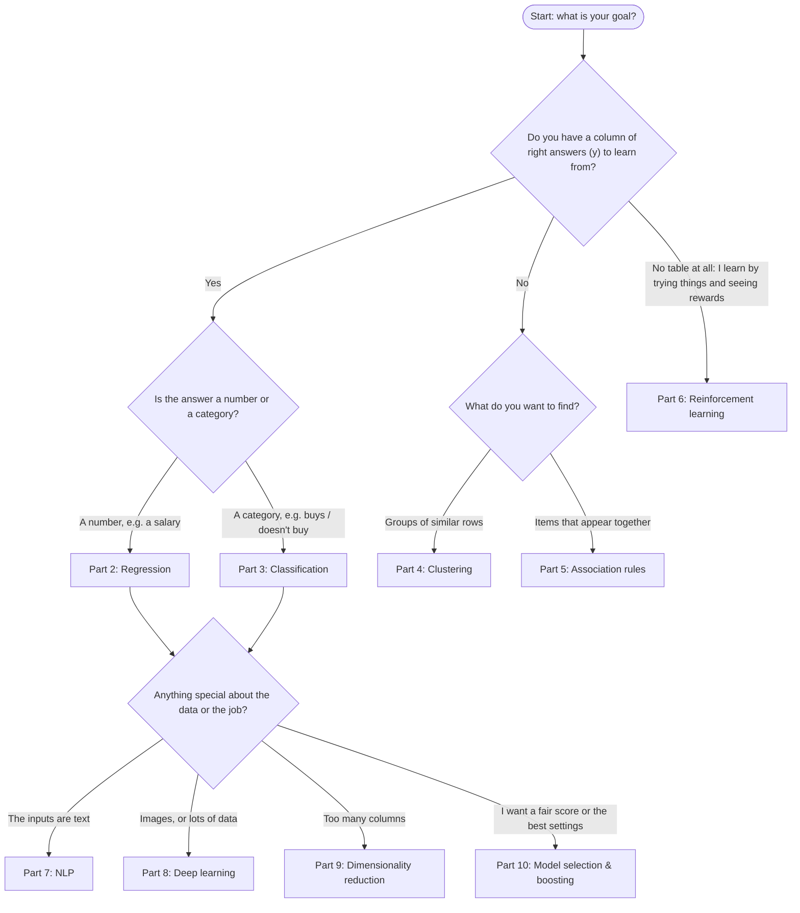

# Learning Path

A step-by-step route through the 30 Python notebooks in this repo, from cleaning data to boosting, with a map of how the topics fit together and side-by-side results so you can compare the models.

---

## How to use this repo

1. **Open a notebook** (in Jupyter, VS Code or Google Colab), following the order below.
2. **Read the explanation cells.** Before most code cells there is a plain-English note saying what the code does, *why* it does it, and how to read the output.
3. **Run the cells from top to bottom** (in Jupyter: *Run All*, or Shift+Enter one cell at a time). Later cells use variables made by earlier ones, so don't skip ahead.
4. **Compare your output with the notes.** Most numbers should match exactly because of `random_state`. Thompson Sampling and the neural networks use randomness, so their numbers will differ a little from run to run.
5. **Do the exercises at the bottom.** Every notebook ends with a **"Try this yourself"** section (small changes to experiment with) and a **"Check your understanding"** section (questions to test yourself). Don't skip these. Changing things and seeing what happens is how the ideas stick.
6. **Look up new words** in the [Glossary](GLOSSARY.md).

### Setup

Install Python 3, then install the libraries once:

```bash
pip install numpy pandas matplotlib scikit-learn xgboost nltk apyori tensorflow
```

- Each notebook expects its **data file in the same folder** as the notebook (for example `Social_Network_Ads.csv` next to `logistic_regression.ipynb`). They are already there, so run the notebook from its own folder.
- **The CNN notebook is the exception.** It needs a cat/dog photo dataset that is **not included** in this repo. Download a cats-vs-dogs image set and arrange it as `dataset/training_set/{cats,dogs}`, `dataset/test_set/{cats,dogs}` and `dataset/single_prediction/cat_or_dog_1.jpg` next to the notebook (the notebook explains the layout).
- The NLP notebook downloads NLTK's stopword list the first time it runs, so it needs internet access once.
- The R versions (`R/` folders) need R and their own packages. They are optional extras.

---

## The big picture

Almost every machine-learning task falls into one of a few families. Knowing which family your problem belongs to tells you which Part to open.

### 1. Supervised learning: learning from examples with answers

You have a table **and** a column of right answers (y). The model studies the examples, then predicts the answer for new rows. It's like a student learning from a workbook with an answer key.

- **Regression (Part 2):** the answer is a **number**. *"What salary goes with level 6.5?"*
- **Classification (Part 3):** the answer is a **category**. *"Will this person buy: yes or no?"*

### 2. Unsupervised learning: finding patterns with no answers

There is **no** answer column. The computer looks for structure on its own, like sorting a pile of photos into piles without being told the categories.

- **Clustering (Part 4):** find **groups** of similar rows (types of shoppers).
- **Association rules (Part 5):** find **items that go together** (people who buy pasta also buy escalope).

### 3. Reinforcement learning: learning by trial and reward (Part 6)

There is no table to study up front. The program **acts**, sees a **reward**, and improves its next choice, like learning which slot machine pays best by playing them.

### 4. Tools you combine with the above

- **Data preprocessing (Part 1):** cleaning data before any model. You'll use it in every project.
- **Natural language processing (Part 7):** turning **text** into numbers so a classifier can use it.
- **Deep learning (Part 8):** **neural networks** for big tables (ANN) and **images** (CNN).
- **Dimensionality reduction (Part 9):** squeezing **many columns into a few**, to simplify models and draw charts.
- **Model selection & boosting (Part 10):** **fairer scoring** (k-fold), **automatic tuning** (grid search) and a **very strong model** (XGBoost).

### What kind of problem do I have?



Whatever the answer, **Part 1 (data preprocessing) comes first**: almost every real dataset needs cleaning.

---

## Recommended order

Work through these 30 steps in order. Each Part builds on the one before. Each step links the Python notebook and the R version, where one exists.

### Part 1: Data Preprocessing

1. **[data_preprocessing_tools](Part%201%20-%20Data%20Preprocessing/Section%202%20--------------------%20Part%201%20-%20Data%20Preprocessing%20--------------------/Python/data_preprocessing_tools.ipynb)**, R: [missing_data.R](Part%201%20-%20Data%20Preprocessing/Section%202%20--------------------%20Part%201%20-%20Data%20Preprocessing%20--------------------/R/missing_data.R), [categorical_data.R](Part%201%20-%20Data%20Preprocessing/Section%202%20--------------------%20Part%201%20-%20Data%20Preprocessing%20--------------------/R/categorical_data.R)
   - *What you'll learn:* how to fill missing values, turn words into numbers (one-hot and label encoding), split into training and test sets, and scale columns.
   - *When you'd use it:* at the start of almost every project, whenever your data has gaps, text categories or columns on very different scales.
2. **[data_preprocessing_template](Part%201%20-%20Data%20Preprocessing/Section%202%20--------------------%20Part%201%20-%20Data%20Preprocessing%20--------------------/Python/data_preprocessing_template.ipynb)**, R: [data_preprocessing_template.R](Part%201%20-%20Data%20Preprocessing/Section%202%20--------------------%20Part%201%20-%20Data%20Preprocessing%20--------------------/R/data_preprocessing_template.R)
   - *What you'll learn:* the short starter skeleton (load the libraries and the data, split into X and y, train/test split) that you copy into new projects.
   - *When you'd use it:* as the first cell block of any new notebook; add the cleaning tools from step 1 only if your data needs them.

### Part 2: Regression (predicting a number)

3. **[simple_linear_regression](Part%202%20-%20Regression/Section%204%20-%20Simple%20Linear%20Regression/Python/simple_linear_regression.ipynb)**, R: [simple_linear_regression.R](Part%202%20-%20Regression/Section%204%20-%20Simple%20Linear%20Regression/R/simple_linear_regression.R)
   - *What you'll learn:* how to fit the best straight line (least squares) to predict salary from years of experience, and how to check it with charts.
   - *When you'd use it:* when one input and the answer rise or fall together in a roughly straight line.
4. **[multiple_linear_regression](Part%202%20-%20Regression/Section%205%20-%20Multiple%20Linear%20Regression/Python/multiple_linear_regression.ipynb)**, R: [multiple_linear_regression.R](Part%202%20-%20Regression/Section%205%20-%20Multiple%20Linear%20Regression/R/multiple_linear_regression.R)
   - *What you'll learn:* linear regression with several inputs (including a one-hot-encoded State) to predict startup profit, and the dummy variable trap.
   - *When you'd use it:* when several inputs each add to or subtract from a number in a roughly straight-line way.
5. **[polynomial_regression](Part%202%20-%20Regression/Section%206%20-%20Polynomial%20Regression/Python/polynomial_regression.ipynb)**, R: [polynomial_regression.R](Part%202%20-%20Regression/Section%206%20-%20Polynomial%20Regression/R/polynomial_regression.R)
   - *What you'll learn:* how adding powers of an input (level², level³ …) lets a linear model draw a curve, compared side by side with a straight line.
   - *When you'd use it:* when the relationship clearly bends (for example, salaries that shoot up at the top).
6. **[support_vector_regression](Part%202%20-%20Regression/Section%207%20-%20Support%20Vector%20Regression%20%28SVR%29/Python/support_vector_regression.ipynb)**, R: [svr.R](Part%202%20-%20Regression/Section%207%20-%20Support%20Vector%20Regression%20%28SVR%29/R/svr.R)
   - *What you'll learn:* SVR's "tube" of tolerance, the RBF kernel, and why both X and y must be scaled (and unscaled) here.
   - *When you'd use it:* when you want a smooth curve that isn't dragged around by a single extreme value.
7. **[decision_tree_regression](Part%202%20-%20Regression/Section%208%20-%20Decision%20Tree%20Regression/Python/decision_tree_regression.ipynb)**, R: [decision_tree_regression.R](Part%202%20-%20Regression/Section%208%20-%20Decision%20Tree%20Regression/R/decision_tree_regression.R)
   - *What you'll learn:* how a tree of yes/no questions predicts numbers, and why its prediction line is a staircase.
   - *When you'd use it:* with many inputs and lots of data, when simple rules or thresholds drive the answer and you don't want to scale.
8. **[random_forest_regression](Part%202%20-%20Regression/Section%209%20-%20Random%20Forest%20Regression/Python/random_forest_regression.ipynb)**, R: [random_forest_regression.R](Part%202%20-%20Regression/Section%209%20-%20Random%20Forest%20Regression/R/random_forest_regression.R)
   - *What you'll learn:* how averaging many trees, each trained on a random sample, gives steadier predictions than one tree.
   - *When you'd use it:* as a strong, low-fuss default for number prediction on table data.

### Part 3: Classification (predicting a category)

All seven notebooks use the same data (400 people, age and salary, bought or not) and the same 300 / 100 split, so their results compare directly. See [table B](#b-classification-on-social_network_ads).

9. **[logistic_regression](Part%203%20-%20Classification/Section%2014%20-%20Logistic%20Regression/Python/logistic_regression.ipynb)**, R: [logistic_regression.R](Part%203%20-%20Classification/Section%2014%20-%20Logistic%20Regression/R/logistic_regression.R)
   - *What you'll learn:* turning inputs into a probability with an S-curve, the confusion matrix, accuracy, and how to draw decision regions with a meshgrid.
   - *When you'd use it:* as the first, simple, explainable model for any yes/no question.
10. **[k_nearest_neighbors](Part%203%20-%20Classification/Section%2015%20-%20K-Nearest%20Neighbors%20%28K-NN%29/Python/k_nearest_neighbors.ipynb)**, R: [knn.R](Part%203%20-%20Classification/Section%2015%20-%20K-Nearest%20Neighbors%20%28K-NN%29/R/knn.R)
    - *What you'll learn:* classifying by a vote of the 5 most similar people, and why that makes a curvy boundary.
    - *When you'd use it:* on small to medium datasets where "similar things behave similarly" and the boundary is irregular.
11. **[support_vector_machine](Part%203%20-%20Classification/Section%2016%20-%20Support%20Vector%20Machine%20%28SVM%29/Python/support_vector_machine.ipynb)**, R: [svm.R](Part%203%20-%20Classification/Section%2016%20-%20Support%20Vector%20Machine%20%28SVM%29/R/svm.R)
    - *What you'll learn:* the straight line with the widest gap (margin), and what support vectors are.
    - *When you'd use it:* when the classes can be split by a straight line and you want the safest such line.
12. **[kernel_svm](Part%203%20-%20Classification/Section%2017%20-%20Kernel%20SVM/Python/kernel_svm.ipynb)**, R: [kernel_svm.R](Part%203%20-%20Classification/Section%2017%20-%20Kernel%20SVM/R/kernel_svm.R)
    - *What you'll learn:* the kernel trick and the RBF kernel, which let an SVM draw a smooth curved boundary.
    - *When you'd use it:* when a straight line keeps missing a group that sits in a curved region.
13. **[naive_bayes](Part%203%20-%20Classification/Section%2018%20-%20Naive%20Bayes/Python/naive_bayes.ipynb)**, R: [naive_bayes.R](Part%203%20-%20Classification/Section%2018%20-%20Naive%20Bayes/R/naive_bayes.R)
    - *What you'll learn:* classifying with probabilities (prior × likelihood) using bell curves, and why it is called "naive".
    - *When you'd use it:* when you need something very fast to train, especially with many inputs (it is a classic for text).
14. **[decision_tree_classification](Part%203%20-%20Classification/Section%2019%20-%20Decision%20Tree%20Classification/Python/decision_tree_classification.ipynb)**, R: [decision_tree_classification.R](Part%203%20-%20Classification/Section%2019%20-%20Decision%20Tree%20Classification/R/decision_tree_classification.R)
    - *What you'll learn:* a chain of yes/no questions chosen by entropy, box-shaped regions, and what overfitting looks like on a chart.
    - *When you'd use it:* when you want rules a person can read and follow, and no scaling.
15. **[random_forest_classification](Part%203%20-%20Classification/Section%2020%20-%20Random%20Forest%20Classification/Python/random_forest_classification.ipynb)**, R: [random_forest_classification.R](Part%203%20-%20Classification/Section%2020%20-%20Random%20Forest%20Classification/R/random_forest_classification.R)
    - *What you'll learn:* how a team of trees that vote reduces the memorising of a single tree.
    - *When you'd use it:* as a strong, reliable default classifier for table data.

### Part 4: Clustering (finding groups)

16. **[k_means_clustering](Part%204%20-%20Clustering/Section%2024%20-%20K-Means%20Clustering/Python/k_means_clustering.ipynb)**, R: [k_means_clustering.R](Part%204%20-%20Clustering/Section%2024%20-%20K-Means%20Clustering/R/k_means_clustering.R)
    - *What you'll learn:* how K-Means groups 200 mall shoppers, how to choose K with the elbow method (WCSS), and what k-means++ does.
    - *When you'd use it:* to split customers or items into a chosen number of groups, even on large datasets.
17. **[hierarchical_clustering](Part%204%20-%20Clustering/Section%2025%20-%20Hierarchical%20Clustering/Python/hierarchical_clustering.ipynb)**, R: [hc.R](Part%204%20-%20Clustering/Section%2025%20-%20Hierarchical%20Clustering/R/hc.R)
    - *What you'll learn:* bottom-up merging, how to read a dendrogram to pick the number of clusters, and Ward linkage.
    - *When you'd use it:* on smaller datasets when you want to see how groups nest inside each other before choosing how many to keep.

### Part 5: Association Rule Learning (what goes together)

18. **[apriori](Part%205%20-%20Association%20Rule%20Learning/Section%2028%20-%20Apriori/Python/apriori.ipynb)**, R: [apriori.R](Part%205%20-%20Association%20Rule%20Learning/Section%2028%20-%20Apriori/R/apriori.R)
    - *What you'll learn:* finding "if A then B" rules in 7,501 shopping baskets, scored by support, confidence and lift.
    - *When you'd use it:* for shop layouts, "frequently bought together" lists and bundle deals.
19. **[eclat](Part%205%20-%20Association%20Rule%20Learning/Section%2029%20-%20Eclat/Python/eclat.ipynb)**, R: [eclat.R](Part%205%20-%20Association%20Rule%20Learning/Section%2029%20-%20Eclat/R/eclat.R)
    - *What you'll learn:* a simpler version that ranks pairs of items only by how often they appear together (support).
    - *When you'd use it:* when you just want the most common item pairs, with no "A leads to B" direction.

### Part 6: Reinforcement Learning (learning by trying)

20. **[upper_confidence_bound](Part%206%20-%20Reinforcement%20Learning/Section%2032%20-%20Upper%20Confidence%20Bound%20%28UCB%29/Python/upper_confidence_bound.ipynb)**, R: [upper_confidence_bound.R](Part%206%20-%20Reinforcement%20Learning/Section%2032%20-%20Upper%20Confidence%20Bound%20%28UCB%29/R/upper_confidence_bound.R)
    - *What you'll learn:* the multi-armed bandit problem, and exploring vs exploiting with an "average + uncertainty bonus" score.
    - *When you'd use it:* to pick the best of several options (ads, page designs) while they are live, wasting as few showings as possible.
21. **[thompson_sampling](Part%206%20-%20Reinforcement%20Learning/Section%2033%20-%20Thompson%20Sampling/Python/thompson_sampling.ipynb)**, R: [thompson_sampling.R](Part%206%20-%20Reinforcement%20Learning/Section%2033%20-%20Thompson%20Sampling/R/thompson_sampling.R)
    - *What you'll learn:* the same problem solved with random guesses drawn from each option's Beta distribution.
    - *When you'd use it:* the same situations as UCB. In practice it often settles on the winner faster and earns more clicks.

### Part 7: Natural Language Processing (text)

22. **[natural_language_processing](Part%207%20-%20Natural%20Language%20Processing/Section%2036%20-%20Natural%20Language%20Processing/Python/natural_language_processing.ipynb)**, R: [natural_language_processing.R](Part%207%20-%20Natural%20Language%20Processing/Section%2036%20-%20Natural%20Language%20Processing/R/natural_language_processing.R)
    - *What you'll learn:* cleaning text (stopwords, stemming), turning it into a bag of words, and classifying 1,000 restaurant reviews as positive or negative (73% accuracy).
    - *When you'd use it:* for sorting reviews, emails, tickets or any short texts into categories.

### Part 8: Deep Learning (neural networks)

23. **[artificial_neural_network](Part%208%20-%20Deep%20Learning/Section%2039%20-%20Artificial%20Neural%20Networks%20%28ANN%29/Python/artificial_neural_network.ipynb)**, R: [ann.R](Part%208%20-%20Deep%20Learning/Section%2039%20-%20Artificial%20Neural%20Networks%20%28ANN%29/R/ann.R)
    - *What you'll learn:* building, compiling and training a small neural network (neurons, layers, ReLU, sigmoid, Adam, epochs, batches) to predict which bank customers leave (86% accuracy).
    - *When you'd use it:* on larger table datasets with complex patterns that simpler models miss.
24. **[convolutional_neural_network](Part%208%20-%20Deep%20Learning/Section%2040%20-%20Convolutional%20Neural%20Networks%20%28CNN%29/Python/convolutional_neural_network.ipynb)** (no R version)
    - *What you'll learn:* convolution, pooling, flattening and image augmentation, used to tell cats from dogs.
    - *When you'd use it:* whenever the input is an image.

### Part 9: Dimensionality Reduction (fewer columns)

All three use the Wine data (178 wines, 13 measurements, 3 customer segments) with the same 142 / 36 split. See [table D](#d-dimensionality-reduction-on-wine).

25. **[principal_component_analysis](Part%209%20-%20Dimensionality%20Reduction/Section%2043%20-%20Principal%20Component%20Analysis%20%28PCA%29/Python/principal_component_analysis.ipynb)**, R: [pca.R](Part%209%20-%20Dimensionality%20Reduction/Section%2043%20-%20Principal%20Component%20Analysis%20%28PCA%29/R/pca.R)
    - *What you'll learn:* squeezing 13 columns into 2 principal components without using the labels, then classifying and plotting.
    - *When you'd use it:* to simplify, speed up or visualise data with many columns, when you have no labels or don't want to use them.
26. **[linear_discriminant_analysis](Part%209%20-%20Dimensionality%20Reduction/Section%2044%20-%20Linear%20Discriminant%20Analysis%20%28LDA%29/Python/linear_discriminant_analysis.ipynb)**, R: [lda.R](Part%209%20-%20Dimensionality%20Reduction/Section%2044%20-%20Linear%20Discriminant%20Analysis%20%28LDA%29/R/lda.R)
    - *What you'll learn:* how LDA uses the labels to find the 2 directions that best separate the classes.
    - *When you'd use it:* as a step before a classifier, when you have labels and want the groups as far apart as possible.
27. **[kernel_pca](Part%209%20-%20Dimensionality%20Reduction/Section%2045%20-%20Kernel%20PCA/Python/kernel_pca.ipynb)**, R: [kernel_pca.R](Part%209%20-%20Dimensionality%20Reduction/Section%2045%20-%20Kernel%20PCA/R/kernel_pca.R)
    - *What you'll learn:* adding the kernel trick to PCA so it can follow curved patterns.
    - *When you'd use it:* when plain PCA's straight directions can't pull the groups apart.

### Part 10: Model Selection & Boosting (judging and tuning)

28. **[k_fold_cross_validation](Part%2010%20-%20Model%20Selection%20_%20Boosting/Section%2048%20-%20Model%20Selection/Python/k_fold_cross_validation.ipynb)**, R: [k_fold_cross_validation.R](Part%2010%20-%20Model%20Selection%20_%20Boosting/Section%2048%20-%20Model%20Selection/R/k_fold_cross_validation.R)
    - *What you'll learn:* giving a model 10 "mini exams" instead of one, and reading the average score and standard deviation (90.33% ± 6.57%).
    - *When you'd use it:* every time you want a trustworthy score, or need to compare models fairly.
29. **[grid_search](Part%2010%20-%20Model%20Selection%20_%20Boosting/Section%2048%20-%20Model%20Selection/Python/grid_search.ipynb)**, R: [grid_search.R](Part%2010%20-%20Model%20Selection%20_%20Boosting/Section%2048%20-%20Model%20Selection/R/grid_search.R)
    - *What you'll learn:* automatically trying 40 combinations of settings (kernel, C, gamma) and keeping the best (90.67%).
    - *When you'd use it:* once you've chosen a model and want to tune its settings instead of guessing.
30. **[xg_boost](Part%2010%20-%20Model%20Selection%20_%20Boosting/Section%2049%20-%20XGBoost/Python/xg_boost.ipynb)**, R: [xg_boost.R](Part%2010%20-%20Model%20Selection%20_%20Boosting/Section%2049%20-%20XGBoost/R/xg_boost.R)
    - *What you'll learn:* gradient boosting, where each new tree fixes the previous trees' mistakes, used to tell benign from malignant tumours.
    - *When you'd use it:* when you want top accuracy on table-shaped data. It is often the winning model in competitions.

---

## Comparison tables

All numbers below come from the saved outputs in the notebooks. Where a notebook has no saved output, the table says "run it to see".

### A. Regression on Position_Salaries

10 job levels, from $45,000 (level 1) to $1,000,000 (level 10). The question: what salary fits **level 6.5**, which sits between level 6 ($150,000) and level 7 ($200,000)? All models learn from all 10 rows (there is no test set).

| Model | Prediction for level 6.5 | Shape of the fitted line | Needs feature scaling? | Notes |
|---|---|---|---|---|
| Linear regression (baseline, polynomial notebook) | **$330,379** | Straight | No | Far above both neighbours. A straight line can't follow the upward bend (underfitting). |
| Polynomial regression (degree 4) | **$158,862** | Smooth curve | No | Passes very close to every point. A higher degree risks overfitting. |
| Support Vector Regression (RBF) | **$170,370** | Smooth curve | **Yes**, both X and y | Treats the CEO's $1M as an outlier, so the curve falls short at level 10. |
| Decision tree | **$150,000** | Staircase (one step per level) | No | Just copies level 6's salary. With 1 input and 10 rows, a tree can't do better. |
| Random forest (10 trees) | **$167,000** | Staircase with more, smaller steps | No | The average of 10 trees, so it lands between the levels. |

**What this tells you:** on a smooth, bending curve with very little data, the curve-fitting models (polynomial, SVR) give the most believable answers. Trees shine with more inputs and much more data.

### B. Classification on Social_Network_Ads

400 people (Age, Estimated Salary → Purchased?). Every model is tested on the **same 100 unseen people**.

Confusion matrices are written `[[TN FP] [FN TP]]`: the top row is the people who didn't buy (correct, false alarms) and the bottom row is the people who did buy (missed, correct).

| Model | Confusion matrix | Accuracy | Boundary shape | Needs scaling? | Notes |
|---|---|---|---|---|---|
| Logistic regression | `[[65 3] [8 24]]` | **89%** | Straight | Yes | Simple and explainable. Misses 8 buyers a straight line can't reach. |
| K-NN (K = 5) | `[[64 4] [3 29]]` | **93%** | Curved, irregular | **Yes, essential** (it measures distances) | Slow to predict on big data, because it searches all neighbours. |
| SVM (linear) | `[[66 2] [8 24]]` | **90%** | Straight | Yes | Fewest false alarms (2), but the same 8 missed buyers as logistic regression. |
| Kernel SVM (RBF) | `[[64 4] [3 29]]` | **93%** | Smooth curve | Yes | Bends around the buyers the straight lines missed. |
| Naive Bayes (Gaussian) | `[[65 3] [7 25]]` | **90%** | Smooth curve | Not strictly (kept to match the others) | Very fast to train. Assumes age and salary are independent clues. |
| Decision tree (entropy) | `[[62 6] [3 29]]` | **91%** | Boxy (horizontal and vertical edges) | No (kept for plotting) | No depth limit, so it overfits: little "islands" around single training dots. |
| Random forest (10 trees) | `[[63 5] [4 28]]` | **91%** | Boxy, a blend of many boxes | No (kept for plotting) | Same score as one tree, with a different mix of mistakes. More trees usually make it steadier. |

**What this tells you:** the data has a curved pattern. The two curved-boundary models (K-NN and Kernel SVM) score best at 93%, mainly because they catch more buyers (only 3 missed, against 8 for the straight-line models). The straight-line models (logistic, linear SVM) top out around 89–90%. Trees land in between.

**A word of caution:** 100 test people is a small exam. One or two people more or less changes the score by 1–2 points, so a 91% vs 93% gap could be luck from this particular split. Part 10's **k-fold cross validation** gives a fairer score by averaging 10 mini exams. For example, Kernel SVM's single-test 93% becomes **90.33% ± 6.57%** across 10 folds.

### C. Clustering: K-Means vs Hierarchical

Both notebooks group the same 200 mall shoppers by annual income and spending score, and both find **5 similar groups**.

| | K-Means | Hierarchical (agglomerative, Ward) |
|---|---|---|
| How K (the number of groups) is chosen | **Before** fitting, using the **elbow method** on WCSS. The elbow is at 5. | **After** building the tree, by cutting the **dendrogram**. A sensible cut gives 5 (3 is also reasonable). |
| Speed on big data | **Fast.** It scales well to many thousands of rows. | **Slow.** It compares every pair of groups, so it suits small to medium datasets. |
| What you get out | A group number (0–4) for each customer **plus the centroids** (centre points). | A group number (0–4) for each customer **plus the whole merge tree**. There are no centroids. |
| Same result every run? | Only with a fixed `random_state` (the starting centroids are random, made smarter by k-means++). | Yes. The merging has no randomness. |

### D. Dimensionality reduction on Wine

178 wines × 13 chemical measurements → **2 new columns**, then logistic regression predicts the customer segment (1, 2 or 3) for the **36 test wines**.

| Method | Uses the labels (y)? | Straight or curved? | Confusion matrix | Accuracy |
|---|---|---|---|---|
| PCA | **No** (unsupervised) | Straight directions | `[[14 0 0] [1 15 0] [0 0 6]]` | **97.2%** (35 / 36) |
| LDA | **Yes** (supervised) | Straight directions | `[[14 0 0] [0 16 0] [0 0 6]]` | **100%** (36 / 36) |
| Kernel PCA (RBF) | **No** (unsupervised) | Curved (kernel trick) | `[[14 0 0] [0 16 0] [0 0 6]]` | **100%** (36 / 36) |

**What this tells you:** all three keep almost all the useful information while throwing away 11 of the 13 columns. LDA can aim straight at separating the segments because it sees the labels. With only 36 test wines, the 1-wine gap between 97% and 100% is too small to read much into.

### E. Bandits: UCB vs Thompson Sampling

10 ads, 10,000 visitors, one ad shown per visitor. The best ad in the data is **Ad 5** (about 27% of visitors would click it).

| | Upper Confidence Bound (UCB) | Thompson Sampling |
|---|---|---|
| Deterministic or random? | **Deterministic.** Same data gives the same choices every run. | **Random.** It draws random guesses and sets no seed, so each run differs a little. |
| How it explores | Adds an **uncertainty bonus** to each ad's average. Rarely shown ads get a big bonus, and the bonus shrinks as an ad is shown more. | Draws a **random guess** from each ad's **Beta distribution**. Little-known ads give wild guesses, so they sometimes win a turn. |
| Result | Settles on **Ad 5**: shown **6,323 times**, with **2,178 total clicks**.* | Settles on **Ad 5**, which clearly dominates the histogram. The total clicks aren't printed: **run it to see**. The notebook notes it often earns more total clicks than UCB. |

\* The UCB notebook only saves the histogram. These two numbers come from re-running its (deterministic) code on `Ads_CTR_Optimisation.csv`, and they match the figures in its explanation cells.

---

## How to study each notebook

Use this checklist for every notebook:

- [ ] **Read the "big picture" cell first.** Can you say in one sentence what the data is and what is being predicted or found?
- [ ] **Look at the raw data.** Open the CSV or print the first rows. What is X? What is y (if there is one)?
- [ ] **Run every cell in order**, reading each explanation cell *before* its code cell.
- [ ] **Predict before you run.** Guess what a cell will print, then check. Surprises are where you learn.
- [ ] **Check the numbers** against the explanation cells (they should match, apart from random methods).
- [ ] **Read the charts properly:** what is on each axis, what the colours mean, and where the mistakes are.
- [ ] **Note which preprocessing steps were used and why** (scaling? encoding? train/test split?).
- [ ] **Compare with the previous notebook** in the same Part. What changed in the code (often just one line)? What changed in the results?
- [ ] **Do "Try this yourself"** at the bottom: change one setting at a time and see what happens.
- [ ] **Answer "Check your understanding"** without looking back, then check.
- [ ] **Look up any new word** in the [Glossary](GLOSSARY.md).
- [ ] **Optional:** open the R version and spot the same steps in a different language.
- [ ] **Write a one-line summary** in your own words: the problem, the method and the result.
